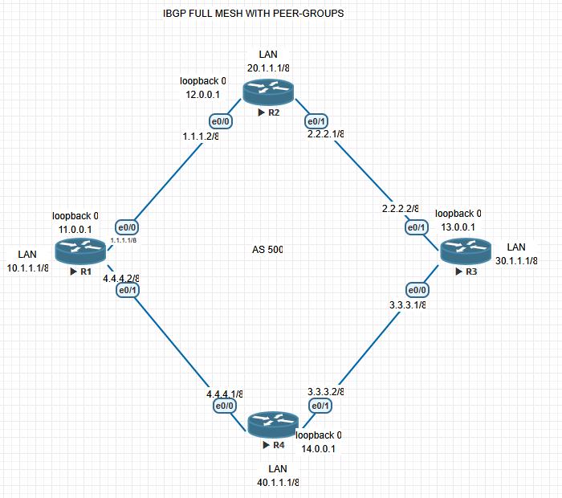
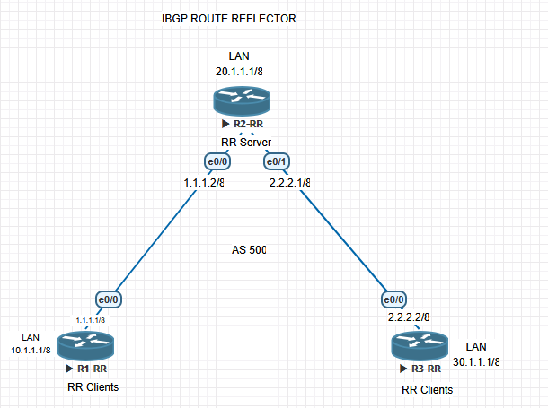

# iBGP Full Mesh and Route Reflector in EVE-NG

I built two separate iBGP scenarios on one EVE-NG canvas. On the left, four routers use peer groups to configure a full mesh. On the right, R2-RR acts as a route reflector for R1-RR and R3-RR. The scenarios have **no link between them**; each stands on its own in AS 500.

I saved seven sanitized startup configurations from the latest supplied export, topology screenshots, and screenshots of live BGP output from every router. The Cisco image and original EVE-NG export are not included. The saved configs predate a later OSPF change in the full mesh; I am waiting for a new export before updating them.

The latest ZIP contains one EVE-NG `.unl` topology file with seven nodes, six link segments, and seven embedded startup configs. It contains no CLI outputs or screenshots; those were supplied separately. I used the `.unl` file to verify that the two groups of routers have no link between them, then kept the original archive out of the public project.

## 1. Full mesh with peer groups

R1, R2, R3, and R4 form a physical ring. The iBGP configuration points each router at the other three routers' loopback addresses. That is **six unique iBGP sessions**, even though the screenshot shows only four physical links. OSPF area 0 provides the underlay between the routers and their loopbacks. The [addressing table](docs/addressing.md) maps each link to its saved interface addresses.

| Router | Loopback0 | Connected LAN | BGP peer group | LAN prefix originated |
| --- | --- | --- | --- | --- |
| R1 | `11.0.0.1/32` | `10.1.1.1/8` | `IBGP-PEERS` | `10.0.0.0/8` |
| R2 | `12.0.0.1/32` | `20.1.1.1/8` | `IBGP-PEERS` | `20.0.0.0/8` |
| R3 | `13.0.0.1/32` | `30.1.1.1/8` | `IBGP-PEERS` | `30.0.0.0/8` |
| R4 | `14.0.0.1/32` | `40.1.1.1/8` | `IBGP-PEERS` | `40.0.0.0/8` |

The current [full-mesh configs](configs/full-mesh) show all three loopback neighbors on each router, with `update-source Loopback0` on each `IBGP-PEERS` group. The fresh CLI screenshots show three established neighbors per router and all four LAN prefixes in each BGP table after the rename. My first export had two R1 mistakes; the [configuration review](docs/config-review.md) records how I found and corrected them.

## 2. Route reflector with two clients

In this separate topology, R1-RR and R3-RR each have a direct link to R2-RR. The [R2-RR config](configs/route-reflector/R2-RR.cfg) sets both neighbors as `route-reflector-client`; the clients peer only with R2-RR. This design uses **two iBGP sessions** in this three-router scenario. A three-router full mesh would need three. The scenarios use different numbers of routers, so I use them to compare the configuration approaches rather than performance.

| Node | Role | Connected LAN | iBGP neighbor |
| --- | --- | --- | --- |
| R1-RR | Client | `10.1.1.1/8` | R2-RR at `1.1.1.2` |
| R2-RR | Route reflector | `20.1.1.1/8` | R1-RR at `1.1.1.1`; R3-RR at `2.2.2.2` |
| R3-RR | Client | `30.1.1.1/8` | R2-RR at `2.2.2.1` |

The current [route-reflector configs](configs/route-reflector) show the corrected `/8` mask and distinct router names. They also advertise the direct transit networks. In the BGP screenshots, R1-RR learns `30.0.0.0/8` with next hop `2.2.2.2`, and R3-RR learns `10.0.0.0/8` with next hop `1.1.1.1`. I still need routing-table output to confirm next-hop resolution and forwarding. See [configuration review](docs/config-review.md).

## What the CLI screenshots show

| Scenario | Evidence | Result shown |
| --- | --- | --- |
| Full mesh | [R1](evidence/full-mesh/R1-bgp.png) · [R2](evidence/full-mesh/R2-bgp.png) · [R3](evidence/full-mesh/R3-bgp.png) · [R4](evidence/full-mesh/R4-bgp.png) | After the rename, each router had three established iBGP neighbors and saw all four LAN prefixes in its BGP table. |
| Full mesh, later routing check | [R1 and ping](evidence/full-mesh/R1-routing-and-ping.png) · [R2](evidence/full-mesh/R2-routing.png) · [R3](evidence/full-mesh/R3-routing.png) · [R4](evidence/full-mesh/R4-routing.png) | All three remote LAN routes appear as `B [200/0]` on each router; R1's sourced ping to R3 succeeded 5/5. |
| Route reflector | [R1-RR](evidence/route-reflector/R1-RR-bgp.png) · [R2-RR](evidence/route-reflector/R2-RR-bgp.png) · [R3-RR](evidence/route-reflector/R3-RR-bgp.png) | R2-RR has both client sessions established. R1-RR sees R3-RR's `30.0.0.0/8`, and R3-RR sees R1-RR's `10.0.0.0/8`. |

The BGP screenshots verify session state and routes in the **BGP tables at the time captured**. After the `IBGP-PEERS` rename, the full-mesh peers each show one prefix received. R2-RR shows two from each client; each client shows four from R2-RR.

In those earlier full-mesh captures, remote LAN entries had an `r` status (`RIB-failure` in the IOS legend). The later `show ip route` screenshots show all three remote LAN `/8` routes installed as `B [200/0]` on each full-mesh router. On R1, the route to `13.0.0.1/32` still appears through OSPF, and a sourced ping from `10.1.1.1` to `30.1.1.1` succeeded 5/5. These observations verify routing-table installation and that one end-to-end test, not every possible path. I still need the post-change saved export to confirm the exact OSPF configuration and fresh BGP summaries. The [verification checklist](docs/verification.md) tracks the evidence.

## Compare the two approaches

| | Full mesh | Route reflector |
| --- | --- | --- |
| Routers in this scenario | Four | Three |
| Unique iBGP sessions | Six | Two |
| Neighbor setup | Each router peers with every other router's loopback; peer groups reduce repeated commands. | Both clients peer with R2-RR; R2-RR marks them as reflector clients. |
| Remote LAN route | Learned from its origin router over a direct iBGP session. | Learned through R2-RR without a client-to-client session. |
| Underlay in this lab | OSPF area 0 reaches the loopbacks. | Direct links, with the transit networks also advertised in BGP. |

## Recreate the lab

1. Create an EVE-NG lab with seven router nodes using your own legally obtained, EVE-NG-compatible router image. Name them R1–R4 and R1-RR–R3-RR.
2. Make the four-router ring and the separate three-router topology shown in the screenshots. Keep the scenarios disconnected. The [addressing table](docs/addressing.md) lists every link and LAN interface.
3. Apply the matching sanitized config from [full mesh](configs/full-mesh) or [route reflector](configs/route-reflector). Interface names can vary by image; adjust them if needed. The full-mesh public configs have no BGP password. If you choose to use authentication, set the same new secret on both ends of every peering.
4. Save each router config. If your image holds an unconnected LAN Ethernet interface down, attach that interface to an isolated EVE-NG network so its connected `/8` route exists.
5. Run `show ip bgp summary` and `show ip bgp` on all routers. Use the [verification commands](docs/verification.md) to check next-hop reachability and forwarding.

The original EVE-NG ZIP and Cisco router image are not included. The addresses shown here are from an isolated practice lab; replace them with appropriate private or assigned addresses outside the lab.

## What I learned

The physical links do not tell the whole iBGP story: the full mesh peers by loopback, while the route reflector clients peer directly with R2-RR. Checking the saved configs caught a missing loopback update source, a missing R1 BGP network statement, and an address-mask mismatch. Fresh BGP captures confirmed the sessions and route exchange after I standardized the peer-group name. I also learned to check the IP routing table: OSPF originally advertised the same LANs, so BGP could learn them without being used to forward traffic. The later routing-table captures show the remote LANs installed from BGP.
